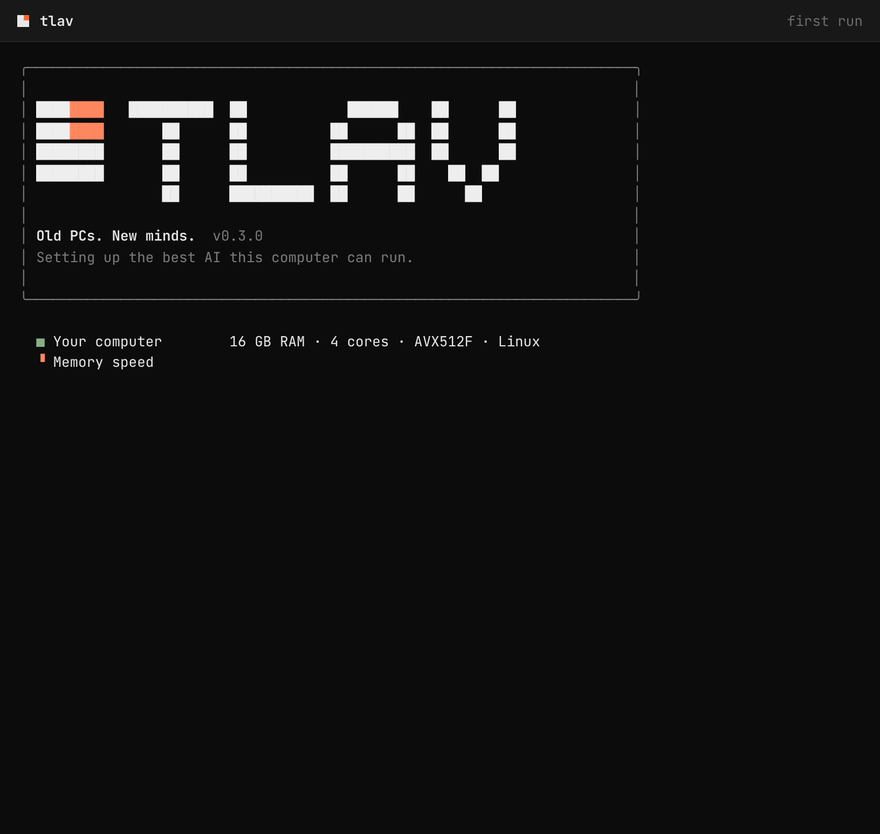
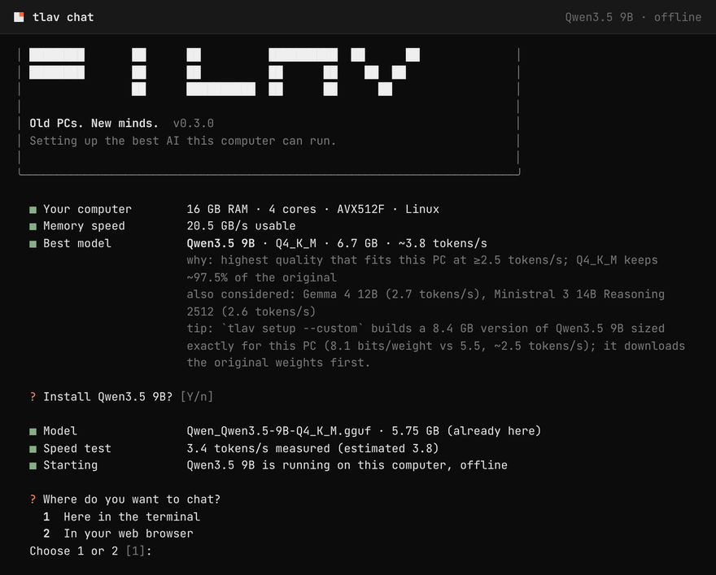
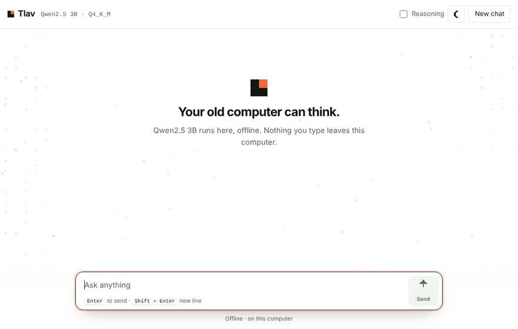
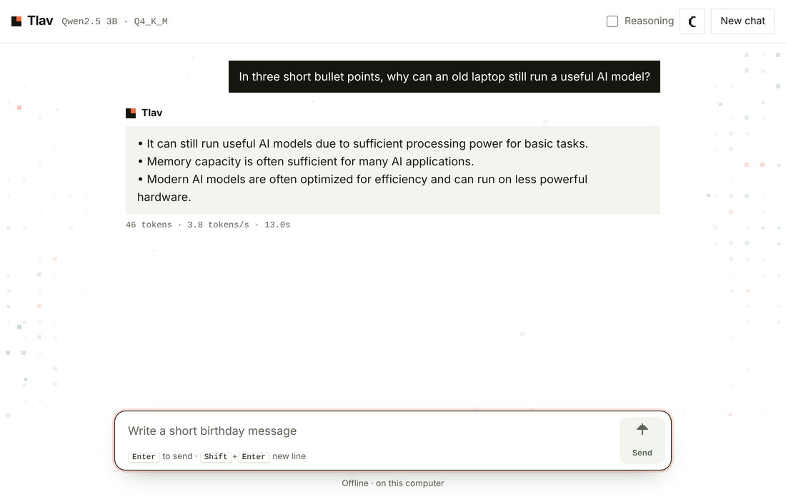
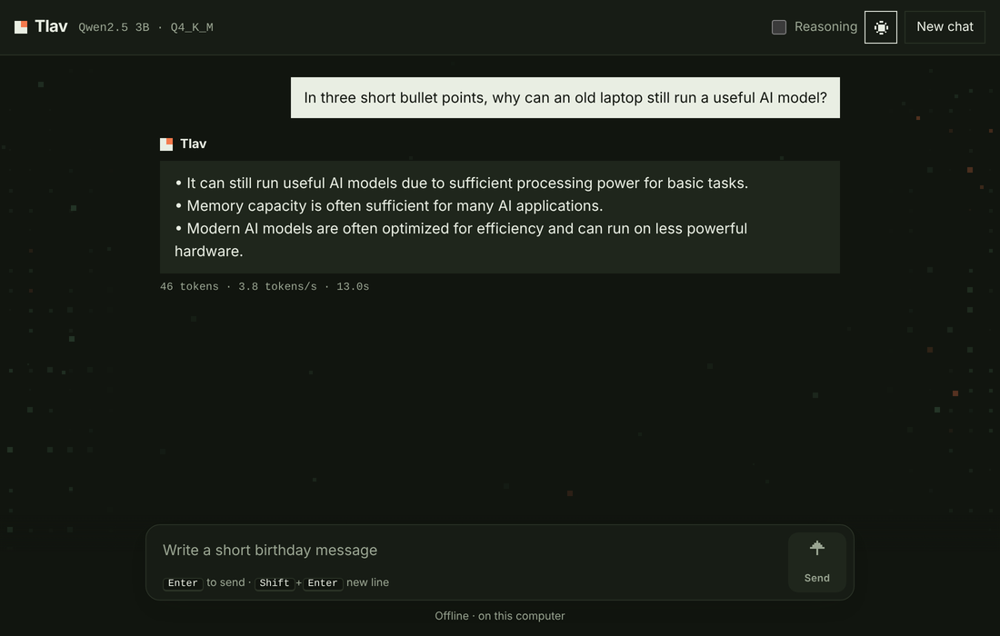
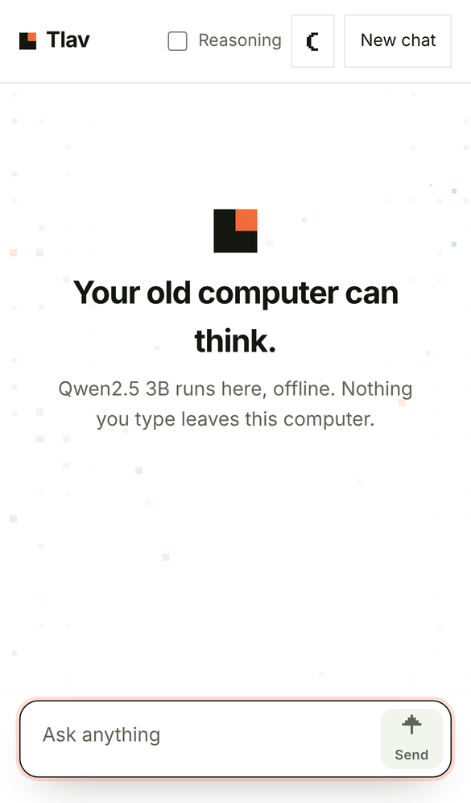
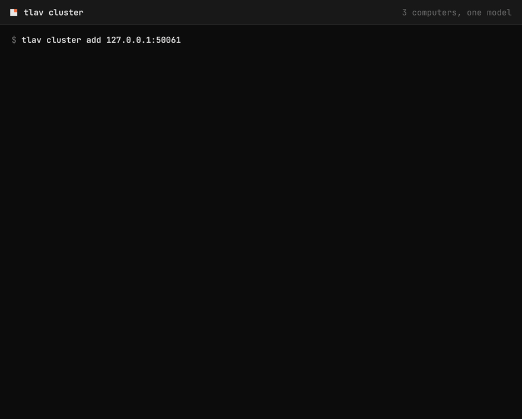

<p align="center">
  
</p>

<p align="center">
  <b>Your old computer can run a private AI.</b><br>
  Tlav picks the best model it can handle, shrinks it to fit and starts a chat. Offline, with one command.
</p>

<p align="center">
  <a href="https://tlav.online"></a>
  <a href="https://github.com/ArhaanDev24/Tlav/actions/workflows/ci.yml"></a>
  
  
  
  <a href="LICENSE"></a>
</p>

<p align="center">
  <a href="#install"></a>
  <a href="#see-it-work"></a>
  <a href="#chat"></a>
  <a href="#how-it-picks"></a>
  <a href="#cluster"></a>
  <a href="#commands"></a>
  <a href="docs/GUIDE.md"></a>
</p>

<br>

<p align="center">
  
  <br><sub>A real run on a 16 GB, 4-core PC. Only the one-minute speed test is sped up.</sub>
</p>

<table>
  <tr>
    <td width="33%" valign="top"><br><b>Knows your PC</b><br><sub>RAM, CPU, disk and real memory speed.</sub></td>
    <td width="33%" valign="top"><br><b>Finds the best model</b><br><sub>50+ models, checked against the real files.</sub></td>
    <td width="33%" valign="top"><br><b>Shrinks it to fit</b><br><sub>Near-lossless, and quality-checked.</sub></td>
  </tr>
  <tr>
    <td valign="top"><br><b>Makes it faster</b><br><sub>Same answers, more words per second.</sub></td>
    <td valign="top"><br><b>Opens a chat</b><br><sub>In your terminal or your browser.</sub></td>
    <td valign="top"><br><b>Pools old PCs</b><br><sub>Several computers, one bigger model.</sub></td>
  </tr>
</table>

## Install

**macOS / Linux** (in Terminal)
```bash
curl -fsSL https://tlav.online/install.sh | bash
```

**Windows** (in PowerShell)
```powershell
irm https://tlav.online/install.ps1 | iex
```

Then just type `tlav`. You only need Python 3.8+, and on Windows the installer offers to install it for you.

## See it work

<table>
  <tr>
    <td width="50%" valign="top"><b>Terminal chat</b><br><br></td>
    <td width="50%" valign="top"><b>Web chat</b><br><br></td>
  </tr>
</table>

<table>
  <tr>
    <td width="40%" align="center"><br><sub>White</sub></td>
    <td width="40%" align="center"><br><sub>Dark</sub></td>
    <td width="20%" align="center"><br><sub>Phone</sub></td>
  </tr>
</table>

<sub>All real recordings. MP4s: <a href="docs/media/setup.mp4">setup</a> · <a href="docs/media/chat.mp4">terminal</a> · <a href="docs/media/web-chat.mp4">web</a> · <a href="docs/media/cluster.mp4">cluster</a></sub>

## Chat

Type `tlav` and choose **terminal** or **browser**. Everything stays on your computer.

`/new` fresh chat · `/think on` smarter, slower · `/save` keep it · `/stats` speed and memory · `/web` open the browser

## How it picks

The strongest model that still runs smoothly on **your** machine:

| Your RAM | Tlav picks | Speed |
|---|---|---|
| 4 GB | Qwen3.5 2B | ~8 tok/s |
| 8 GB | Qwen3.5 4B | ~5 tok/s |
| 16 GB | Qwen3.5 9B | ~3 tok/s |
| **2 × 16 GB** | **Qwen3.6 35B, split across both** | ~7 tok/s |

<sub>Typical picks for a 2013 iMac. Try yours: <code>tlav recommend</code></sub>

## Cluster

Run `tlav worker` on spare computers, then `tlav setup --cluster` on the main one. Their memory adds up, so you can run a bigger, smarter model.

<p align="center">
  
</p>

<sub>Use it on a home network you trust. Wired Ethernet is best.</sub>

## Commands

| Command | What it does |
|---|---|
| `tlav` | Set up, or start chatting |
| `tlav recommend` | What this PC can run |
| `tlav chat` | Terminal chat |
| `tlav run` | Web chat + OpenAI-compatible API |
| `tlav worker` | Lend this PC to a cluster |
| `tlav stop` | Free the memory |

Everything else is in the **[full guide](docs/GUIDE.md)**.

<br>

<p align="center">
  <a href="docs/GUIDE.md"></a>
  <a href="CONTRIBUTING.md"></a>
  <br><br>
  <sub><b>Old PCs. New minds.</b> · MIT licensed</sub>
</p>
