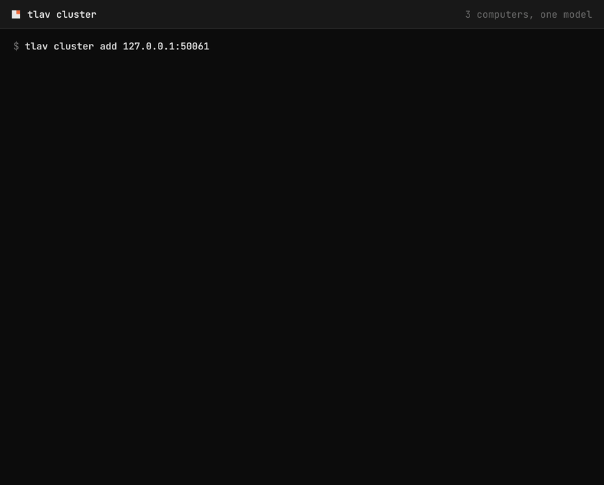

# Tlav guide

Everything Tlav does, in detail. For the short version, see the [README](../README.md).

## What `tlav` does, step by step

1. **Detects** your hardware: RAM, CPU cores, AVX/AVX2/AVX-512, GPU, disk.
2. **Benchmarks** memory bandwidth, which decides how fast a model can talk on a CPU, and self-calibrates against real runs.
3. **Finds the best model** for *this* PC: it ranks the catalog by your specs, then checks the top five against the files that really exist on Hugging Face (exact sizes, no weights downloaded) and tells you why the winner won. Any GGUF on Hugging Face works too (`tlav search`).
4. **Makes it use less RAM** with measured, near-lossless compression and a compressed context cache, then **verifies the quality**.
5. **Speeds it up** with speculative decoding, which gives exactly the same answers, faster.
6. **Measures it**: one quick speed test on the installed model; if your PC is slower than expected, Tlav offers a faster pick.
7. **Opens the Tlav chat** in your terminal. A web chat and an OpenAI-compatible API run too, and it can start at boot as an always-on AI box.

## Install

Requires Python 3.8+ and nothing else. On first setup Tlav builds [llama.cpp](https://github.com/ggml-org/llama.cpp), tuned for your exact CPU.

**macOS / Linux** (in Terminal)
```bash
curl -fsSL https://tlav.online/install.sh | bash
```

**Windows** (in PowerShell)
```powershell
irm https://tlav.online/install.ps1 | iex
```

<details>
<summary>Installing from a downloaded copy instead</summary>

```bash
git clone https://github.com/ArhaanDev24/Tlav
cd Tlav
./install.sh                                              # macOS / Linux
powershell -ExecutionPolicy Bypass -File .\install.ps1    # Windows
```
</details>

### Intel Macs (2010–2020), including the 2013 iMac
Tlav builds llama.cpp from source with AVX2 on and Metal off (old Mac GPUs are slower than the CPU for this). You need Apple's command line tools once:
```bash
xcode-select --install
```

## What will my machine run?

```bash
tlav doctor                   # what Tlav sees
tlav recommend                # ranked models for this machine
tlav recommend --ram 16       # simulate a 16 GB machine
tlav recommend --ram 16 --ram 16   # simulate two 16 GB machines working together
```

Typical picks for a 2013 iMac (quad-core Haswell, DDR3-1600):

| Setup | Best pick | RAM used | Speed |
|---|---|---|---|
| 2 GB (light Linux) | Qwen3.5 0.8B @ Q4_K_M | ~0.8 GB | fast |
| 4 GB | Qwen3.5 2B @ Q8_0 | ~2.3 GB | ~8 tok/s |
| 8 GB | Qwen3.5 4B @ Q5_K_M | ~3.8 GB | ~5 tok/s |
| 16 GB | Qwen3.5 9B @ Q4_K_M | ~6.7 GB | ~2.5–3 tok/s |
| **two 16 GB PCs** | **Qwen3.6 35B-A3B (MoE) @ Q4_K_M, split across both** | ~11 GB each | ~7 tok/s on Ethernet |

`tlav setup --min-tps 5` prefers faster models, and `tlav setup --task code` picks coding models.

## The Tlav chat

`tlav` (or `tlav chat`) opens a chat in your terminal and starts your model if it isn't running. While an old PC gets going, Tlav shows what it's "doing" (*Defragmenting the C: drive…*, *Rewinding the cassette with a pencil…*, *Counting to 640K…*), then the Tlav square follows the words as they are written, with the speed shown after each answer. Conversations are kept on your disk only.

```
  ■ Tlav  Qwen3.5 9B  Q4_K_M
    this PC · 8192 tokens of memory · offline · reasoning off
    Type a message. /help for commands, Ctrl+C stops an answer.

› Explain RAM like I'm ten
  RAM is your computer's desk...
  64 tokens · 2.8 tokens/s · 23.1s
```

| Command | |
|---|---|
| `/new` | fresh conversation (the previous one is kept as `last`) |
| `/system TEXT` | how the assistant should behave |
| `/think on\|off` | let reasoning models think first: smarter, slower (on by default only on fast PCs with a 3B+ model) |
| `/thoughts` | show the reasoning text as it's written (normally only the status line shows progress) |
| `/temp X` | 0 = precise, 1 = creative |
| `/save NAME`, `/load NAME`, `/list` | keep and reopen conversations |
| `/copy` | copy the last answer |
| `/stats` | speed, memory, context used |
| `/web` | open the browser chat |
| `/stop` | stop the model and free its memory |
| `"""` | start/end a message with several lines |

Old turns are left out automatically when a long chat no longer fits the model's memory. `tlav chat --model file.gguf` chats with any file; `tlav chat --url http://host:8080` with a Tlav on another PC.

### The web chat

Choose **web** and Tlav opens its own chat page, served by your own computer: it works with no internet, and on phones too (`tlav run --host 0.0.0.0`, then open the address it prints). It shows the same status lines and Tlav square as the terminal, with the speed after each answer. Reasoning sits in a collapsed "Thought for 12s" section, and there's a Stop button. Conversations stay in that browser.

If the usual port (8080) is taken by another program, Tlav starts on the next free one and tells you, so it never ends up talking to someone else's model.

## Combine computers (cluster mode)

<p align="center">
  
  <br><sub>A real cluster run: two workers join, the model's layers travel to them, and the chat runs across 3 computers.</sub>
</p>

Yes, you can pool several old computers into one bigger AI machine. Tlav uses llama.cpp's RPC backend to **split the model's layers across machines**, so their RAM adds up.

```
 ┌──────────── main PC ────────────┐        ┌──── worker PC ────┐
 │ tlav run --cluster              │  LAN   │ tlav worker       │
 │ layers 1–24 + web chat + API    │ ◄────► │ layers 25–48      │
 └─────────────────────────────────┘        └───────────────────┘
```

**On every helper computer:**
```bash
tlav worker
```

**On the main computer:**
```bash
tlav cluster scan            # finds the workers automatically
tlav recommend --cluster     # what the combined machines can run
tlav setup --cluster         # pick, download, split and run it
```

If your network blocks discovery, add a worker by address: `tlav cluster add 192.168.1.23`.

**What to expect (honestly):**
- **It pools memory, not speed.** Each word passes through every machine in turn, so a split model runs at roughly the speed of its parts added together, plus network delay. Use a cluster to run a *bigger, smarter* model than any one machine could hold. Tlav never splits a model that fits on one computer.
- **Answers are identical** to running on one machine. We tested a 3-way split against a single PC and got word-for-word the same output.
- **Use Ethernet.** Gigabit Ethernet works well, Wi-Fi works but is slower. `tlav cluster list` shows the delay to each worker and rates the connection.
- **Only the main PC downloads the model.** Workers receive their share over the network and cache it, so the next start is faster.
- **Security:** a worker accepts work from anyone who can reach it, with no password. Only run it on a home network you trust, never on public Wi-Fi, and never forward its port (50052) on your router. `tlav worker --token WORD` stops accidental joins but is not real security.

### Watching it connect

While computers connect, and while the model's layers travel to each worker, Tlav draws each link live in the terminal. A packet glides from **this PC** to the worker, then the line settles into a solid connection with its speed:

```
  ■ this PC ━━━━━━━━━━━━━━━━━━━━━━ ■ study-imac   0.4 ms, excellent (wired) · 16 GB RAM, 4 cores
```

Tlav also checks the details that break clusters:
- **Engine versions:** every computer must run the same AI engine build, so Tlav warns and tells you how to fix it if they differ.
- **Changed addresses:** if a router hands a worker a new address, Tlav finds it again by its computer name.

## How Tlav finds the best model

This is Tlav's core job, and it does it like a careful researcher would:

1. **It knows what's new.** Every week (or on `tlav models --update`) Tlav scans Hugging Face for GGUF releases from trusted publishers (bartowski, unsloth, ggml-org, LM Studio). It keeps only **original models from real AI labs**, such as Qwen, Google, Meta, Mistral, Microsoft, NVIDIA and DeepSeek, by following each file's `base_model` link. Merges, role-play tunes, "uncensored" edits, vision/audio-only models and base (non-chat) versions are left out. On the last run: 61 candidates, 51 kept, in 28 seconds.
2. **It reads the real files.** For every candidate it reads the GGUF header over the network: a few hundred KB, never the whole model. That gives exact parameters, layers, context-cache size, mixture-of-experts layout and whether the model can reason step by step.
3. **It counts what actually costs speed.** On a CPU, speed is memory bandwidth ÷ bytes read per word. Tlav leaves out embedding tables (looked up, not read), which are up to a third of a small model. It also counts only the active experts of MoE models. Estimates moved closer to measured: Qwen3.5 9B was estimated at 3.1 tok/s and measured at 3.7 (the old estimate was 2.7).
4. **It scores quality honestly.** About 30 well-known models carry hand-checked quality scores. For new models Tlav uses a formula learned from those scores: roughly +7 points for each doubling of size and +4 for each year newer. It reproduces the hand-checked scores within about 3.5 points on average. Estimated scores are marked `~` and lose ties to checked ones.
5. **It checks the shortlist against reality.** The top 5 for your PC are re-planned with the **exact** download sizes of every compression level that exists (Q4_K_L, IQ4_XS, unsloth's dynamic files...). Real files differ: Qwen3.5 9B's Q4_K_M is 5.75 GB, not the 5.05 GB its parameter count suggests.
6. **It explains the pick** and, after installing, measures the real speed once to calibrate future picks.

```bash
tlav recommend                     # ranked for this PC, with the why
tlav recommend --ram 8             # what an 8 GB machine would get
tlav models --update               # refresh the list from Hugging Face now
tlav search "gemma 4"              # any GGUF on Hugging Face, judged for this PC
tlav setup --hf unsloth/gemma-4-12b-it-GGUF
```

## Less RAM, same quality

Everything below is **measured**, not assumed.

| Technique | What it saves | Quality impact | How Tlav makes sure |
|---|---|---|---|
| **Weight compression** (quantization) | 16 → ~5 bits per weight, 3–4× smaller | Q8/Q6: practically none; Q5: ~1%; Q4_K_M: ~1–3% | Measures perplexity vs the original; any level over 3% is rejected and Tlav steps up a level |
| **Importance-matrix compression** | Same size, protects the weights that matter most | Measured on a 0.5B model: Q3_K_M loss halved (+8.2% → +3.9%) | Tries standard *and* importance-matrix compression, keeps whichever measures better |
| **Compressed context cache** (q8_0 KV) | Halves the memory for conversation history: 2× longer chats, or a bigger model | Measured: +0.3–0.5% | `--kv-check` measures it on your model; above 0.5% it falls back to full precision |
| **Speculative decoding** | (speed) | **Zero**: the output is identical | Tested: Qwen2.5 3B went **9.6 → 15.7 tok/s** with byte-identical output |
| **Right-sized buffers** | Up to 8 GB: llama-server's default prompt cache and extra chat slots | None | One slot for one user; the prompt cache only gets truly spare RAM |
| **mmap / mlock** | Fast loading, nothing swapped out | None | `mlock` only when there's spare RAM; `--low-ram` profile for tight machines |

Want zero noticeable loss? `tlav setup --max-quality` allows only Q6_K/Q8_0 (measured change under 0.5%).

### Exact-fit compression

Ready-made files come in fixed sizes, so a PC usually ends up with a file a bit smaller than it could hold. `tlav setup --custom` (or `tlav compress --model ID --exact`) downloads the original weights and builds a file **sized exactly for your RAM and your minimum speed**. llama.cpp chooses the precision of every tensor separately and uses Tlav's importance matrix, so the most sensitive weights get the most bits.

Measured on Qwen2.5 0.5B against the original:

| File | Size | KL divergence (lower = closer) | Same next word as the original |
|---|---|---|---|
| Q4_K_M, standard | 398 MB | 0.0284 | not measured |
| Q4_K_M, importance matrix (Tlav keeps this one) | 398 MB | 0.0226 | 91.1% |
| **Exact fit, 0.42 GB** | **414 MB** | **0.0072** | **94.3%** |
| Q8_0 | 507 MB | 0.0022 | 98.0% |

For 4% more size, the exact fit is about 3× closer to the original than the best Q4_K_M.

### How quality is checked

Every compression Tlav does is compared with the original using **KL divergence**, the standard measure of quantization damage (0 = identical). Tlav also reports **how often the compressed model picks the same next word**, and the perplexity change. Standard and importance-matrix versions are both built, and the one closer to the original is kept. Anything over the tolerance is rejected, and Tlav steps up a level.

A bigger model compressed to Q4_K_M almost always beats a smaller model kept at full precision. That trade is what lets Tlav run "a larger, better model" on your machine.

## Commands

| Command | What it does |
|---|---|
| `tlav` | Set up on first run; afterwards start your model and ask: terminal or web chat |
| `tlav setup` | Everything: detect → benchmark → pick → download/compress → speed test → chat (`--web` for the browser) |
| `tlav setup --cluster` / `--hf REPO` / `--max-quality` | Use workers / any Hugging Face model / near-lossless only |
| `tlav doctor` | Hardware report, RAM budget, cluster support |
| `tlav bench [--real]` | Bandwidth benchmark; `--real` measures true tok/s and calibrates future estimates |
| `tlav recommend` | Ranked models (`--cluster`, `--task code`, `--ram 16 --ram 8` to simulate) |
| `tlav search QUERY` | Find GGUF models on Hugging Face that fit this machine or cluster |
| `tlav models [--update]` | All known models (hand-checked + found on Hugging Face); `--update` scans for new releases |
| `tlav compress --model ID --fit` | Compress as little as possible to fit, verify quality |
| `tlav compress --model ID --exact` / `--size 5.2` | Build a file sized exactly for this PC / to a size, precision chosen per tensor |
| `tlav compress --file X-f16.gguf --to Q4_K_M --kv-check` | Compress your own model |
| `tlav run [--detach] [--host 0.0.0.0]` | Start the server + web chat (0.0.0.0 = usable from phones/other PCs) |
| `tlav status` / `tlav stop` | What's running and how much memory it really uses / stop it |
| `tlav chat` | The Tlav chat (starts your model if needed) |
| `tlav worker` | Share this PC's RAM and CPU with a main computer |
| `tlav cluster scan/add/list/remove/clear` | Manage workers |
| `tlav service install [--worker]` | Start at login (launchd / systemd / Task Scheduler): an always-on AI box |
| `tlav install-runtime` | Install/rebuild llama.cpp tuned for this CPU |
| `tlav list` | Downloaded models |
| `tlav remove [NAME…]` / `--all` | Delete downloaded models to free disk space (Tlav stays installed); with no name it lists them and asks |
| `tlav uninstall [--keep-models]` | Remove Tlav completely: models, AI engine, chats, settings, startup services and the `tlav` command |

Everything lives in `~/.tlav` (change it with `TLAV_HOME`).

### Removing models, or Tlav itself

```bash
tlav remove            # lists your models with their sizes; pick which to delete
tlav remove gemma      # delete one by name (or part of it, or its number)
tlav remove --all      # delete every model, keep Tlav
tlav uninstall         # remove Tlav completely (asks first)
```

`tlav remove` also deletes the helper files that belong to a model (importance matrices, quality-check data, unfinished downloads). If you delete the model you chat with, Tlav stops it and sets up a new one the next time you type `tlav`.

`tlav uninstall` shows exactly what it will delete and how much space that frees, then removes the models, the AI engine Tlav built, your chats and settings, any startup services and the `tlav` command. Python stays installed. `--keep-models` keeps your downloaded models for later.

## Use it from other apps

`tlav run` exposes an OpenAI-compatible API at `http://127.0.0.1:8080/v1`. Point any app that accepts an OpenAI base URL at it (Open WebUI, Continue, editors, scripts):

```bash
curl http://127.0.0.1:8080/v1/chat/completions -H "Content-Type: application/json" \
  -d '{"messages":[{"role":"user","content":"Hello from my old iMac!"}]}'
```

## How the planner decides

For every model × compression level × (one machine or a cluster):

- **memory** = weights + context cache + runtime buffers. It must fit each machine's budget: total RAM minus room for the OS (at least 2 GB or 25%, plus 1 GB on macOS).
- **speed** ≈ usable bandwidth ÷ bytes read per token. Mixture-of-experts models only count their active experts. Clusters add up each machine's share plus network round trips.
- Models slower than `--min-tps` (default 2.5 tok/s) are dropped. For each model Tlav uses the least compression that still runs at a comfortable 5 tok/s, otherwise the fastest allowed level.
- The winner has the highest quality score after compression. A draft model is added when RAM allows.

Measured on the test machine: memory 2.7 GB actual vs 3.0 GB planned; speed 52 tok/s actual vs 55 planned.

## Development

```bash
pip install -e ".[dev]"
pytest
```

CI runs the unit tests on Linux, macOS and Windows. It also runs an end-to-end job that builds llama.cpp, compresses and quality-checks a model, serves it, and splits it across a 3-machine cluster, checking that the answers match.

Contributions are welcome: see [CONTRIBUTING.md](../CONTRIBUTING.md).
